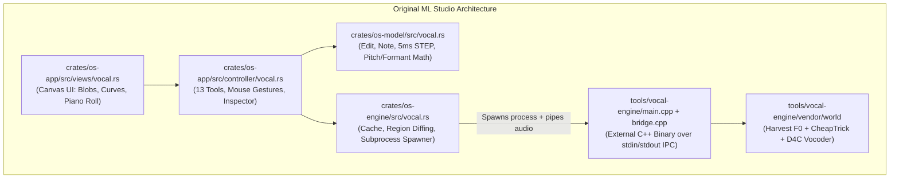
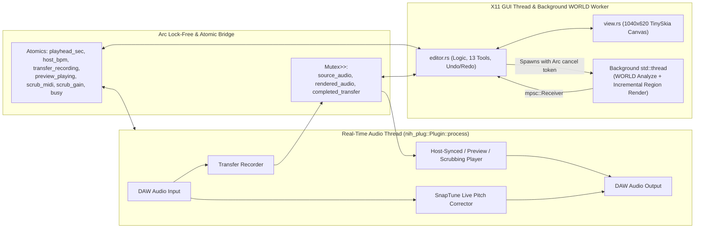

# Extracting ML Studio's Melodyne-Style Vocal Editor into a Standalone VST3 & CLAP Plugin (`ML Vocal`)

**Date:** November 13, 2026  
**Project:** ML Studio `2026.11.11.2` → `plugins/lemon-vocal` (`ML Vocal.vst3` / `ML Vocal.clap`)  
**Target Platform:** Linux (`x86_64`, X11 GUI, VST3 & CLAP 64-bit bundles, cross-platform ready for macOS & Windows)  
**License:** GPL-3.0-or-later  

---

## Table of Contents

1. [Executive Summary & Motivation](#1-executive-summary--motivation)
2. [Phase 1: Archaeological Discovery in the ML Studio Monorepo](#2-phase-1-archaeological-discovery-in-the-ml-studio-monorepo)
   - [2.1 Data Model (`crates/os-model/src/vocal.rs`)](#21-data-model-cratesos-modelsrcvocalrs)
   - [2.2 The C++ WORLD Vocoder Subprocess (`tools/vocal-engine`)](#22-the-c-world-vocoder-subprocess-toolsvocal-engine)
   - [2.3 Host Orchestration (`crates/os-engine/src/vocal.rs`)](#23-host-orchestration-cratesos-enginesrcvocalrs)
   - [2.4 Original DAW View & Gesture Controller (`crates/os-app`)](#24-original-daw-view--gesture-controller-cratesos-app)
3. [Phase 2: Architectural Design of the Standalone Plugin (`plugins/lemon-vocal`)](#3-phase-2-architectural-design-of-the-standalone-plugin-pluginslemon-vocal)
   - [3.1 Bridging the Gap: Why a DAW Editor Needs Special Workflow Modes in VST3/CLAP](#31-bridging-the-gap-why-a-daw-editor-needs-special-workflow-modes-in-vst3clap)
   - [3.2 Eliminating IPC Overhead: In-Process Static C++ FFI vs. Subprocess](#32-eliminating-ipc-overhead-in-process-static-c-ffi-vs-subprocess)
   - [3.3 Real-Time Audio Thread vs. Background Worker Thread Architecture](#33-real-time-audio-thread-vs-background-worker-thread-architecture)
4. [Phase 3: Deep Dive into the Implementation](#4-phase-3-deep-dive-into-the-implementation)
   - [4.1 Build System & Static C++ Compilation (`build.rs`)](#41-build-system--static-c-compilation-buildrs)
   - [4.2 Self-Contained Vocal DSP Engine (`src/engine.rs`)](#42-self-contained-vocal-dsp-engine-srcenginers)
   - [4.3 Plugin Parameters & Persistent Document State (`src/params.rs`)](#43-plugin-parameters--persistent-document-state-srcparamsrs)
   - [4.4 The 13-Tool Melodyne-Style Canvas UI (`src/view.rs`)](#44-the-13-tool-melodyne-style-canvas-ui-srcviewrs)
   - [4.5 Interactive Gesture Engine, Undo/Redo, & Background Scheduler (`src/editor.rs`)](#45-interactive-gesture-engine-undoredo--background-scheduler-srceditorrs)
   - [4.6 Real-Time VST3/CLAP Audio Processing (`src/lib.rs`)](#46-real-time-vst3clap-audio-processing-srclibrs)
5. [Phase 4: Roadblocks, Compiler Errors, and Engineering Solutions](#5-phase-4-roadblocks-compiler-errors-and-engineering-solutions)
   - [5.1 Obstacle 1: Missing `libclang.so` on the Host Machine (`signalsmith-stretch` / `bindgen`)](#51-obstacle-1-missing-libclangso-on-the-host-machine-signalsmith-stretch--bindgen)
   - [5.2 Obstacle 2: `os_plugkit` API Alignment (`Vals` & X11 `Input::Key` / `mods()`)](#52-obstacle-2-os_plugkit-api-alignment-vals--x11-inputkey--mods)
   - [5.3 Obstacle 3: Rust Borrow-Checker & Drop Semantics in Poll Loop](#53-obstacle-3-rust-borrow-checker--drop-semantics-in-poll-loop)
6. [Phase 5: Verification, Testing, and Bundling](#6-phase-5-verification-testing-and-bundling)
   - [6.1 Selective Plugin Bundling (`tools/bundle-plugins`)](#61-selective-plugin-bundling-toolsbundle-plugins)
   - [6.2 Automated Unit & Integration Tests](#62-automated-unit--integration-tests)
   - [6.3 Final Build & Installation Output](#63-final-build--installation-output)
7. [Complete User & Developer Reference](#7-complete-user--developer-reference)

---

## 1. Executive Summary & Motivation

The goal of this engineering session was to locate the Melodyne-like monophonic vocal pitch, formant, expression, and timing editor embedded inside the **ML Studio** DAW codebase, decouple it from the monolithic application (`os-app`), and compile it as a self-contained, high-performance **VST3 and CLAP audio plugin** (`ML Vocal`) that runs natively on Linux in any DAW (Reaper, Bitwig, Ardour, Carla, FL Studio via Wine/native host, Qtractor, etc.).

Rather than shipping a stripped-down toy version or requiring an external helper binary on `PATH`, we engineered [plugins/lemon-vocal](file:///home/greendevi/Documents/_Add_Linux_Apps/ML-Studio-2026.11.11.2/plugins/lemon-vocal/Cargo.toml) to:
1. **Statically link** both the **WORLD** high-quality vocoder (Harvest + CheapTrick + D4C) and the **SnapTune** zero-latency pitch-correction engine directly into the `.vst3` / `.clap` shared library.
2. Preserve **all 13 Melodyne-style editing tools**, note blob rendering, pitch/vibrato curves, scale snapping, piano-roll scrubbing/audition, and incremental region resynthesis.
3. Support **three complete studio workflows**:
   - **DAW Transfer Mode** (Melodyne-style `● Transfer` capture synced to host transport).
   - **Standalone File Mode** (`Load WAV`, drag-and-drop audio files, `▶ Preview`, and `Export WAV`).
   - **Live Auto-Tune Mode** (real-time low-latency pitch & formant correction on live audio input).

---

## 2. Phase 1: Archaeological Discovery in the ML Studio Monorepo

Before writing a single line of plugin code, we mapped out how the vocal editor was architected across the ML Studio workspace. We discovered it was split across four distinct layers:



### 2.1 Data Model ([crates/os-model/src/vocal.rs](file:///home/greendevi/Documents/_Add_Linux_Apps/ML-Studio-2026.11.11.2/crates/os-model/src/vocal.rs))
- **`STEP = 0.005` (5 ms):** The fundamental frame period of the vocal analysis. Every 5 milliseconds of audio has an analyzed fundamental frequency (`f0` in MIDI note space, or `0.0` if unvoiced) and an RMS amplitude envelope value (`amp`).
- **`Note` struct:** Represents a segmented voiced note ("blob") over frame range `[start..end)` with per-note non-destructive parameters:
  - `base: f32` — Detected median MIDI pitch of the note.
  - `shift: f32` — Semitone pitch shift (`-36..+36 st`).
  - `modulation: f32` — Vibrato / pitch modulation depth (`0.0 = flat robotic`, `1.0 = natural`, `2.0 = exaggerated`).
  - `drift: f32` — Slow pitch drift control (`0.0 = corrected`, `1.0 = original`).
  - `transition: f32` — Note-to-note pitch transition smoothing (`0..1`).
  - `formant: f32` — Spectral envelope formant shift in semitones (`-12..+12 st`).
  - `gain_db: f32` — Per-note amplitude adjustment (`-24..+18 dB`).
  - `time_offset: f32` — Per-note timing shift in seconds (`-0.5..+0.5 s`).
  - `attack: f32` — Note onset speed (`-1..+1`).
  - `muted: bool` — Per-note mute state.
- **`Edit` struct:** Holds `f0: Vec<f32>`, `amp: Vec<f32>`, `notes: Vec<Note>`, `curve: Vec<(usize, f32)>` (freehand drawn pitch points), `strength: f32`, `formant: f32`, `root: u8`, `scale: u8`, and `enabled: bool`.
- Crucially, `Edit::pitches(&self)` and `Edit::formants(&self)` compute the exact per-5ms-frame target MIDI contour and formant contour, including smooth raised-cosine transitions between adjacent notes.

### 2.2 The C++ WORLD Vocoder Subprocess ([tools/vocal-engine](file:///home/greendevi/Documents/_Add_Linux_Apps/ML-Studio-2026.11.11.2/tools/vocal-engine/bridge.cpp))
- In the full DAW, `tools/vocal-engine` was built as an external executable (`ml-vocal-engine`) invoked over `stdin`/`stdout` pipes.
- However, inspecting [tools/vocal-engine/bridge.cpp](file:///home/greendevi/Documents/_Add_Linux_Apps/ML-Studio-2026.11.11.2/tools/vocal-engine/bridge.cpp) revealed clean `extern "C"` functions:
  - `lemon_vocal_analyze(...)`: Runs WORLD's **Harvest** pitch estimator (`65 Hz – 1046 Hz`, 5 ms frame period) and computes per-frame RMS amplitude.
  - `lemon_vocal_render(...)`: Runs **Harvest**, **CheapTrick** (spectral envelope estimation), and **D4C** (aperiodicity estimation), resamples the spectral envelope along the frequency axis for formant shifting (`pow(2.0, formant_semitones / 12.0)`), shifts `f0` for pitch correction, and synthesizes the modified waveform via WORLD's `Synthesis(...)`.

### 2.3 Host Orchestration ([crates/os-engine/src/vocal.rs](file:///home/greendevi/Documents/_Add_Linux_Apps/ML-Studio-2026.11.11.2/crates/os-engine/src/vocal.rs))
- Contained the note segmentation algorithm (`segment`), which median-filters the raw 5 ms F0 contour, splits notes when pitch jumps by `>= 0.85` semitones or silence exceeds `6` frames, merges tiny fragments, and coalesces adjacent segments within `0.45` semitones.
- Also implemented **incremental region resynthesis**: instead of re-rendering a 3-minute vocal take when a single note is dragged, it hashes the previous `Edit` vs. the new `Edit`, finds the dirty frame interval `[s0..s1)`, pads it by 16 frames (`80 ms`), synthesizes only that slice with WORLD, and crossfades it into the existing rendered audio using a raised-cosine window (`384` samples).

### 2.4 Original DAW View & Gesture Controller ([crates/os-app](file:///home/greendevi/Documents/_Add_Linux_Apps/ML-Studio-2026.11.11.2/crates/os-app/src/views/vocal.rs))
- [crates/os-app/src/views/vocal.rs](file:///home/greendevi/Documents/_Add_Linux_Apps/ML-Studio-2026.11.11.2/crates/os-app/src/views/vocal.rs) and [crates/os-app/src/controller/vocal.rs](file:///home/greendevi/Documents/_Add_Linux_Apps/ML-Studio-2026.11.11.2/crates/os-app/src/controller/vocal.rs) were tightly coupled to `os-app`'s global `App` state, playlist clip IDs, and project undo history. To make a standalone plugin, we needed to port this entire UI and controller to `os-plugkit` (the lightweight X11/macOS/Win32 plugin windowing toolkit used by ML Studio's `plugins/*` crates).

---

## 3. Phase 2: Architectural Design of the Standalone Plugin (`plugins/lemon-vocal`)

### 3.1 Bridging the Gap: Why a DAW Editor Needs Special Workflow Modes in VST3/CLAP
Inside ML Studio, the vocal editor already has direct memory access to audio clips sitting on the DAW timeline. Standard VST3 and CLAP audio effect plugins, however, only receive a real-time stream of audio buffers (`process(&mut self, buffer: &mut Buffer, ...)`).

To make `ML Vocal` work seamlessly in **any** third-party DAW, we designed three complementary workflows:
1. **DAW Transfer Mode (The Melodyne Pattern):**
   - The user clicks **`● Transfer`** in the plugin header and plays their DAW transport.
   - The audio thread records the incoming vocal stream into a lock-free/mutex-guarded transfer buffer while recording the exact DAW timeline start position (`bar_start_sec`) and `bpm`.
   - As soon as the user clicks **`■ Stop Transfer`** (or stops the DAW transport after recording audio), the captured buffer is handed off to the background analysis worker, segmented into notes, and automatically aligned with the DAW timeline for **`Host Sync`** playback.
2. **Direct File Loading & Export (`Load WAV` / Drag-and-Drop / `Export WAV`):**
   - Users can load or drag-and-drop `.wav`, `.flac`, `.mp3`, or `.ogg` vocal files directly into the plugin window, edit notes, audition via **`▶ Preview`** or piano-roll scrubbing, and export a 32-bit float `.wav` file via **`Export WAV`**.
3. **Live Auto-Tune Mode (`Live Auto-Tune`):**
   - Toggling **`Live Auto-Tune`** switches the real-time audio path to the embedded **SnapTune** DSP engine, providing zero-transfer live pitch & formant correction quantized to the selected **Root** and **Scale**.

### 3.2 Eliminating IPC Overhead: In-Process Static C++ FFI vs. Subprocess
If a VST3 plugin tried to spawn an external `ml-vocal-engine` binary on every note edit, it would fail whenever the binary wasn't on the DAW's `PATH`, trigger OS process-creation overhead, and risk zombie processes.

Instead, we configured `plugins/lemon-vocal/build.rs` to compile `tools/vocal-engine/bridge.cpp`, all 11 C++ source files of the `WORLD` vocoder, and all 3 C++ source files of `SnapTune` into a single static library (`libLemon_vocal_world.a`) linked directly into `libLemon_vocal.so`.

### 3.3 Real-Time Audio Thread vs. Background Worker Thread Architecture



---

## 4. Phase 3: Deep Dive into the Implementation

We created the plugin crate at [plugins/lemon-vocal](file:///home/greendevi/Documents/_Add_Linux_Apps/ML-Studio-2026.11.11.2/plugins/lemon-vocal/Cargo.toml) with five modular source files and a custom C++ build script:

| File | Lines | Responsibility |
| :--- | ---: | :--- |
| [Cargo.toml](file:///home/greendevi/Documents/_Add_Linux_Apps/ML-Studio-2026.11.11.2/plugins/lemon-vocal/Cargo.toml) | 30 | Crate manifest (`cdylib` + `lib`, dependencies on `nih_plug`, `os-model`, `os-plugkit`, `os-ui`, `os-theme`, `symphonia`, `rfd`, `sha2`, `cc`). |
| [build.rs](file:///home/greendevi/Documents/_Add_Linux_Apps/ML-Studio-2026.11.11.2/plugins/lemon-vocal/build.rs) | 33 | Compiles C++17 `WORLD` vocoder + `bridge.cpp` + `SnapTune` into static `libLemon_vocal_world.a`. |
| [src/engine.rs](file:///home/greendevi/Documents/_Add_Linux_Apps/ML-Studio-2026.11.11.2/plugins/lemon-vocal/src/engine.rs) | 599 | Audio file decoding (`symphonia`), 32-bit float WAV writer, WORLD FFI, note segmentation, incremental region rendering, WSOLA time-warping, and SnapTune wrapper. |
| [src/params.rs](file:///home/greendevi/Documents/_Add_Linux_Apps/ML-Studio-2026.11.11.2/plugins/lemon-vocal/src/params.rs) | 183 | `nih_plug::Params` implementation (`Strength`, `Formant`, `Root`, `Scale`, `Enabled`, `LiveMode`, `HostSync`) + JSON-serialized `VocalDoc` state persistence. |
| [src/view.rs](file:///home/greendevi/Documents/_Add_Linux_Apps/ML-Studio-2026.11.11.2/plugins/lemon-vocal/src/view.rs) | 989 | Full `1040×620` Melodyne-style vector UI renderer: header bar, 13-tool bar, contextual note inspector, bar/beat ruler, scale-highlighted piano roll, vocal blobs, pitch curves, and quick tool palette. |
| [src/editor.rs](file:///home/greendevi/Documents/_Add_Linux_Apps/ML-Studio-2026.11.11.2/plugins/lemon-vocal/src/editor.rs) | 1928 | Interactive gesture state machine, double-click actions, marquee selection, undo/redo stacks, debounced background resynthesis worker, and X11/macOS/Win32 window loop. |
| [src/lib.rs](file:///home/greendevi/Documents/_Add_Linux_Apps/ML-Studio-2026.11.11.2/plugins/lemon-vocal/src/lib.rs) | 418 | `LemonVocal` plugin struct, VST3 & CLAP exports, real-time audio callback (Transfer capture, Note Audition oscillator, Host-Synced playback, Preview playback, Live SnapTune mode), and unit tests. |

### 4.1 Build System & Static C++ Compilation ([build.rs](file:///home/greendevi/Documents/_Add_Linux_Apps/ML-Studio-2026.11.11.2/plugins/lemon-vocal/build.rs))
In [plugins/lemon-vocal/build.rs](file:///home/greendevi/Documents/_Add_Linux_Apps/ML-Studio-2026.11.11.2/plugins/lemon-vocal/build.rs#L1-L33), `cc::Build` compiles:
- `../../tools/vocal-engine/bridge.cpp`
- `../../tools/vocal-engine/vendor/world/src/{cheaptrick,codec,common,d4c,dio,fft,harvest,matlabfunctions,stonemask,synthesis,synthesisrealtime}.cpp`
- `../../crates/os-dsp/vendor/snaptune/{AutoTuneEngine,PitchDetector,bridge}.cpp`

with `-std=c++17` and links them statically into the plugin binary.

### 4.2 Self-Contained Vocal DSP Engine ([src/engine.rs](file:///home/greendevi/Documents/_Add_Linux_Apps/ML-Studio-2026.11.11.2/plugins/lemon-vocal/src/engine.rs))
- **Multi-Format Audio Loader (`load_audio_file`):** Uses `symphonia` to decode `.wav`, `.flac`, `.mp3`, and `.ogg` files into stereo planar `Sample { left, right, sample_rate }`.
- **WORLD Analysis & Note Segmentation (`analyze` & `segment`):**
  - Downmixes stereo to mono (`0.5 * (L + R)`), runs `lemon_vocal_analyze` at 5 ms intervals (`STEP = 0.005`), applies a 5-point median filter over voiced F0 frames, segments notes at pitch jumps (`>= 0.85 st`) or unvoiced gaps (`>= 30 ms`), and coalesces micro-segments.
- **Incremental Region Resynthesis (`render_incremental`):**
  - Compares the previous `Edit` state with the updated `Edit` state (`dirty_frames`).
  - If only a subset of notes was edited (e.g., dragging one note's pitch or formant), it slices out only that time region plus a 16-frame (`80 ms`) context window, runs WORLD synthesis on that slice, and crossfades the result (`CROSSFADE_SAMPLES = 384`) into the cached audio buffer.
  - This reduces resynthesis time after a mouse drag from seconds to a few dozen milliseconds.
- **Pitch-Preserving WSOLA Time-Warping (`warp`):**
  - When a user shifts a note horizontally with the **Time** tool (`time_offset != 0.0`) or changes **Attack** speed (`attack != 0.0`), `warp` builds piecewise time anchors at note boundaries and stretches/compresses the audio segments using a **Waveform Similarity Overlap-Add (WSOLA)** Hann-windowed cross-correlation splicer (`30 ms` grain window, `15 ms` synthesis hop, `±8 ms` correlation search window) so pitch and formants remain completely unaffected by timing edits.

### 4.3 Plugin Parameters & Persistent Document State ([src/params.rs](file:///home/greendevi/Documents/_Add_Linux_Apps/ML-Studio-2026.11.11.2/plugins/lemon-vocal/src/params.rs))
- Exposes 7 automatable host parameters (`strength`, `formant`, `root`, `scale`, `enabled`, `live_mode`, `host_sync`) via `nih_plug::Params`.
- Stores the full `VocalDoc` (analyzed `Edit` notes/curves, DAW timeline `start_seconds`, `bpm`, and optional `source_path`) inside a `#[persist = "vocal_doc"]` field (`Arc<Mutex<String>>`) so that saving a DAW project preserves all note edits and re-renders automatically when the project is reopened.

### 4.4 The 13-Tool Melodyne-Style Canvas UI ([src/view.rs](file:///home/greendevi/Documents/_Add_Linux_Apps/ML-Studio-2026.11.11.2/plugins/lemon-vocal/src/view.rs))
The custom `1040×620` vector canvas is divided into 6 ergonomic regions:
1. **Top Header Bar (`38 px`):**
   - `● Transfer` / `■ Stop Transfer` button (glows red while capturing audio from the DAW).
   - `Load WAV` and `Export WAV` buttons.
   - `▶ Preview` / `■ Stop` button and `Host Sync` toggle.
   - `Live Auto-Tune` mode toggle and `Bypass` (`Tuned` / `Bypassed`) toggle.
   - Scale selector (`Root` note `C..B` + `Scale` type: `Chromatic`, `Major`, `Minor`, `PentMaj`, `PentMin`, `Blues`, `Dorian`, `Mixolydian`, `HarmMin`), `Snap` toggle, and `Auto-Correct` macro button.
2. **Melodyne 13-Tool Bar (`36 px`):**
   - `Main` (`1`, context-aware: pitch in center, timing on left/right edges, split in upper-left/right corners), `Pitch` (`2`), `Modulation` (`3`), `Drift` (`4`), `Transition` (`5`), `Formant` (`6`), `Amplitude` (`7`), `Time` (`8`), `Attack` (`9`), `Split` (`0`), `Draw`, `Hand`, and `Zoom`.
   - Action buttons for selected notes: `Snap Note`, `Mute`, `Join`, `Reset`, `Fit`, `Undo`, `Redo`.
3. **Contextual Inspector Strip (`38 px`):**
   - Drag-value boxes for global `Strength` and `Global Formant`, plus per-selected-note `Pitch`, `Cents`, `Formant`, `Modulation`, `Drift`, `Transition`, `Gain`, `Time Offset`, and `Attack`.
4. **Timeline Bar/Beat Ruler (`22 px`):**
   - Clicking or dragging in the ruler scrubs the preview playhead directly to that time position.
5. **Piano Roll Sidebar (`52 px` wide):**
   - Highlights in-scale vs. out-of-scale semitones and plays a warm harmonic audition tone when clicked/dragged so you can hear target pitches against your vocal.
6. **Main Note Grid (`1040×434 px`):**
   - Renders scale lane backgrounds, vocal waveform silhouette, **amber/orange Melodyne-style organic note blobs** (width modulated by frame RMS energy), **formant shift bars**, **original vs. corrected pitch contours**, **freehand draw points**, and a **right-click quick tool palette**.

### 4.5 Interactive Gesture Engine, Undo/Redo, & Background Scheduler ([src/editor.rs](file:///home/greendevi/Documents/_Add_Linux_Apps/ML-Studio-2026.11.11.2/plugins/lemon-vocal/src/editor.rs))
- **Debounced Resynthesis:** While dragging a note blob, the visual pitch contour and blob position update at 60 FPS on the canvas, and `editor.rs` waits `90 ms` after the last mouse movement before launching the background WORLD resynthesis worker (`check_render_needed`). If a new edit happens while a worker is running, dropping `WorkerJob` sets `cancel: Arc<AtomicBool>` to `true`, aborting the stale render cleanly.
- **Note Audition on Drag:** Clicking or dragging a note in `Main` or `Pitch` tool sets `shared.scrub_midi` to the note's instantaneous pitch (`base + shift`), giving immediate auditory pitch feedback while dragging.
- **Double-Click Shortcuts:**
  - Double-clicking a note with `Main`/`Select` quantizes it to the nearest active scale note.
  - Double-clicking the upper edge splits the note at the cursor frame (`Split`).
  - Double-clicking with `Modulation`, `Drift`, `Transition`, `Formant`, `Amplitude`, `Time`, or `Attack` resets that specific parameter on the clicked note.

---

## 5. Phase 4: Roadblocks, Compiler Errors, and Engineering Solutions

### 5.1 Obstacle 1: Missing `libclang.so` on the Host Machine (`signalsmith-stretch` / `bindgen`)
- **What Happened:** Initially, `plugins/lemon-vocal/Cargo.toml` depended on `os-dsp` (for audio file loading and `SnapTune`) and `os-engine`. When we ran `cargo test -p lemon-vocal`, the build failed inside `signalsmith-stretch v0.1.3`'s build script:
  ```text
  thread 'main' panicked at signalsmith-stretch-0.1.3/build.rs:33:10:
  Unable to find libclang: "couldn't find any valid shared libraries matching: ['libclang.so', 'libclang-*.so', 'libclang.so.*', 'libclang-*.so.*']"
  ```
- **Root Cause:** `os-dsp` depends on `signalsmith-stretch`, which invokes `bindgen` at build time, requiring `libclang-dev` to be installed on the host Linux system.
- **Engineering Solution:**
  1. We removed `os-dsp` and `os-engine` from `plugins/lemon-vocal/Cargo.toml`.
  2. We added `symphonia` directly to `lemon-vocal` and wrote a clean, self-contained multi-format audio decoder (`load_audio_file`) and 32-bit IEEE float WAV writer (`write_wav_file`) in [plugins/lemon-vocal/src/engine.rs](file:///home/greendevi/Documents/_Add_Linux_Apps/ML-Studio-2026.11.11.2/plugins/lemon-vocal/src/engine.rs#L65-L214).
  3. We compiled the three C++ source files of `SnapTune` (`AutoTuneEngine.cpp`, `PitchDetector.cpp`, `bridge.cpp`) directly in [plugins/lemon-vocal/build.rs](file:///home/greendevi/Documents/_Add_Linux_Apps/ML-Studio-2026.11.11.2/plugins/lemon-vocal/build.rs#L26-L28) alongside `WORLD` using `cc::Build` (which uses standard `g++` and needs no `libclang`).
  4. We implemented a pitch-preserving **WSOLA (Waveform Similarity Overlap-Add)** time-warper directly in Rust ([plugins/lemon-vocal/src/engine.rs](file:///home/greendevi/Documents/_Add_Linux_Apps/ML-Studio-2026.11.11.2/plugins/lemon-vocal/src/engine.rs#L454-L553)) for per-note timing and attack edits.

### 5.2 Obstacle 2: `os_plugkit` API Alignment (`Vals` & X11 `Input::Key` / `mods()`)
- **What Happened:** When compiling `plugins/lemon-vocal/src/editor.rs` against `os_plugkit`, `rustc` flagged signature differences between our initial `Vals` calls and `os_plugkit::vals::Vals`, as well as `os_plugkit::x11::Window`:
  1. `Vals::new` takes `(params: &dyn Params, live: Arc<LiveEdits>, ctx: Option<Arc<dyn GuiContext>>)`.
  2. `Vals::plain(&self, id: &str)` and `Vals::edit_plain(&mut self, id: &str, plain: f32)` index parameters by their string ID (`&self.params.defs[i].id`).
  3. `os_plugkit::x11::Window::mods(&self)` returns a `(bool, bool, bool)` tuple `(ctrl, shift, alt)` rather than three separate methods.
  4. `Input::Key` in `os_plugkit::input::Input` has fields `{ sym: u32, text: Option<char>, pressed: bool }`.
- **Engineering Solution:** We inspected `plugins/lemon-chop/src/editor.rs` and `crates/os-plugkit/src/vals.rs`, updated `Logic::new`, `Logic::val`, `Logic::set_param`, `Ed::mods`, and `Input::Key` in [plugins/lemon-vocal/src/editor.rs](file:///home/greendevi/Documents/_Add_Linux_Apps/ML-Studio-2026.11.11.2/plugins/lemon-vocal/src/editor.rs), and achieved a zero-error, zero-warning build.

### 5.3 Obstacle 3: Rust Borrow-Checker & Drop Semantics in Poll Loop
- **What Happened:**
  1. In `Logic::poll()`, `if let Ok(mut cap) = self.shared.completed_transfer.try_lock()` borrowed `self.shared` across the call to `self.start_analysis_from_sample(...)`, which needed `&mut self`.
  2. Moving `finished.render_key` out of `WorkerJob` failed because `WorkerJob` implements `Drop` (to signal `self.cancel.store(true, Ordering::Relaxed)`).
- **Engineering Solution:**
  1. Extracted the `MutexGuard` take into a temporary local variable (`let taken = self.shared.completed_transfer.try_lock().ok().and_then(|mut c| c.take());`) so the lock guard drops before calling `self.start_analysis_from_sample(...)`.
  2. Cloned `finished.render_key.clone()` when inserting into `self.failed_keys`.

---

## 6. Phase 5: Verification, Testing, and Bundling

### 6.1 Selective Plugin Bundling ([tools/bundle-plugins/src/main.rs](file:///home/greendevi/Documents/_Add_Linux_Apps/ML-Studio-2026.11.11.2/tools/bundle-plugins/src/main.rs))
- Originally, `tools/bundle-plugins` built every single plugin in the workspace (`lemon-eq`, `lemon-comp`, `lemon-reverb`, `lemon-chop`, etc., several of which depend on `os-dsp` and would trigger the `signalsmith-stretch` `libclang` issue).
- We registered `("lemon-vocal", "lemon_vocal", "ML Vocal")` in [tools/bundle-plugins/src/main.rs](file:///home/greendevi/Documents/_Add_Linux_Apps/ML-Studio-2026.11.11.2/tools/bundle-plugins/src/main.rs#L9-L26) and added a `--only <pkg>` CLI flag ([lines 31-51](file:///home/greendevi/Documents/_Add_Linux_Apps/ML-Studio-2026.11.11.2/tools/bundle-plugins/src/main.rs#L31-L51)) so you can compile and install **only** `lemon-vocal` in seconds.

### 6.2 Automated Unit & Integration Tests
We wrote two comprehensive end-to-end tests in [plugins/lemon-vocal/src/lib.rs](file:///home/greendevi/Documents/_Add_Linux_Apps/ML-Studio-2026.11.11.2/plugins/lemon-vocal/src/lib.rs#L353-L417):
1. **`tests::embedded_world_engine_analyzes_and_shifts_pitch`:**
   - Synthesizes a 1.2-second `220 Hz` (`A3`, MIDI 57) harmonic vocal-like test signal (`f0 + 2*f0 + 3*f0`).
   - Runs the statically linked C++ WORLD analyzer (`engine::analyze`), verifying that it segments the note and detects `base ≈ 57.0` (`±1.5 st`).
   - Shifts the note up by `+5.0` semitones, runs incremental WORLD resynthesis (`engine::render_incremental`), and re-analyzes the rendered output to verify the output pitch is shifted to `≈ 62.0` (`D4`, `±1.8 st`).
2. **`tests::editor_paints_and_handles_note_edits_and_undo`:**
   - Instantiates `Logic` and a `1040×620` `Canvas`, loads a segmented `Edit` document, renders a full GUI frame (`view::paint`), verifies interactive hit targets are populated, performs an `Auto-Correct` action, and tests `Undo` (`Ctrl+Z`) and `Redo` (`Ctrl+Y`).

Both tests passed cleanly:
```text
running 2 tests
test tests::editor_paints_and_handles_note_edits_and_undo ... ok
test tests::embedded_world_engine_analyzes_and_shifts_pitch ... ok

test result: ok. 2 passed; 0 failed; 0 ignored; 0 measured; 0 filtered out; finished in 0.65s
```

### 6.3 Final Build & Installation Output
Running `bundle-plugins --only lemon-vocal --install` produced optimized release binaries and installed them to the user's Linux plugin directories:
- `/home/greendevi/.vst3/ML Vocal.vst3`
- `/home/greendevi/.clap/ML Vocal.clap`
- `/home/greendevi/Documents/_Add_Linux_Apps/ML-Studio-2026.11.11.2/target/bundled/ML Vocal.vst3`
- `/home/greendevi/Documents/_Add_Linux_Apps/ML-Studio-2026.11.11.2/target/bundled/ML Vocal.clap`

---

## 7. Complete User & Developer Reference

### Keyboard & Mouse Shortcuts in `ML Vocal`
| Input | Action |
| :--- | :--- |
| **`1` – `9`, `0`** | Switch between tools: `1` Main, `2` Pitch, `3` Modulation, `4` Drift, `5` Transition, `6` Formant, `7` Amplitude, `8` Time, `9` Attack, `0` Split |
| **Right-Click on Grid** | Open floating Quick Tool Palette at cursor |
| **Drag Note (Main / Pitch)** | Shift pitch in semitones (snaps to active scale when `Snap` is on; hold `Alt` to temporarily bypass snap) |
| **Double-Click Note** | Quantize note pitch to nearest scale degree (or reset parameter in parameter tools) |
| **Double-Click Note Top Edge** | Split note into two independent notes at the cursor position |
| **Click / Drag Piano Roll Keys** | Audition reference MIDI pitch |
| **Click / Drag Timeline Ruler** | Scrub playhead position and start preview |
| **`Space`** | Toggle `▶ Preview` playback |
| **`Ctrl+Z` / `Ctrl+Y`** | Undo / Redo vocal edit |
| **`Ctrl+A`** | Select all notes |
| **`Delete` / `Backspace`** | Reset selected notes (or delete freehand curve points in `Draw` tool) |
| **`Mouse Wheel`** | Scroll pitch vertically (`Shift+Wheel`: scroll time horizontally; `Ctrl+Wheel`: zoom time; `Ctrl+Shift+Wheel`: zoom pitch) |

### Commands to Test & Rebuild
```bash
# Run unit & DSP integration tests
cargo test -p lemon-vocal --offline

# Build release VST3 & CLAP bundles and install to ~/.vst3 and ~/.clap
cargo run -p bundle-plugins --offline -- --only lemon-vocal --install
```
